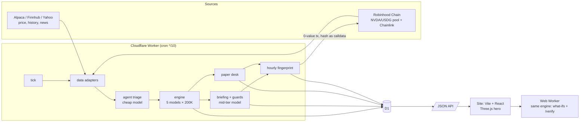

# Architecture

One Cloudflare Worker serves the static site, the JSON API and the 10-minute cron. Storage is Cloudflare D1.



## Tick (every 10 minutes)

1. Fetch the stock quote and the on-chain token price.
2. Refresh daily history once per day. Triage new headlines and update news intensity.
3. Run the 1M-path engine. While the market is closed this happens every 30 minutes, priced off the token.
4. Update the paper desk. Write a briefing every 30 minutes, or immediately on big news or a move over 3%.
5. At the first tick of each hour, fingerprint the previous hour and retry any pending fingerprints.
6. At 00:30 ET, score matured horizons for the scorecard.

## AI cost control

Every OpenRouter call logs tokens and cost to `ai_usage`. Once the daily cap is reached (`AI_DAILY_CAP_USD`, default $4), briefings and desk notes switch to code-written templates until midnight ET. Live usage is shown at `/api/health`.

## Repo

```
engine/   pure TS engine (zero deps) + tests + verify CLI
worker/   Worker: cron, API, adapters, agent, desk, proof, D1 schema
web/      Vite + React site, Three.js hero, engine Web Worker
docs/     these documents
```
